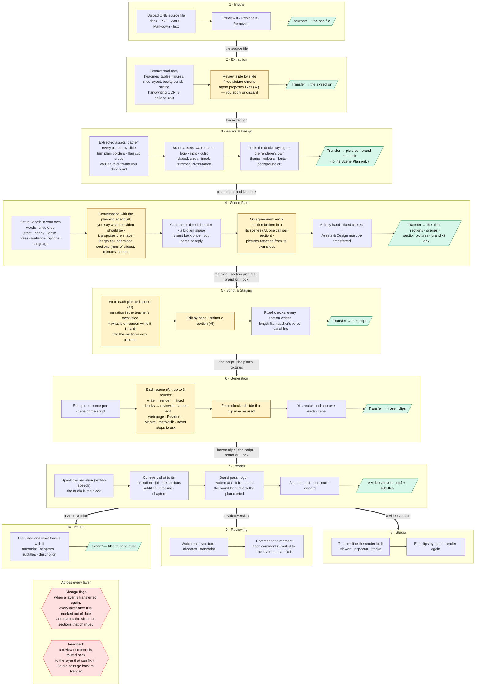

# Workflow diagram

How a project moves from one source file to a finished video: what each layer
takes in, what it does, and what it hands on. This is a working draft, written
to be edited into the project's direction.

**How to read it**

- Each band is a layer, top to bottom in the order the work flows. Inside it,
  left to right, are the actions it takes, ending with what it hands on.
- **(AI)** marks an action that calls a model. Everything else is a fixed rule
  or a person's choice.
- A thick arrow is a **transfer**, labelled with what is handed on. A layer
  reads only what was transferred, never what is still being worked on.
- The two boxes at the foot run across every layer: change flags going down,
  and feedback going back.

## The rules every layer keeps

| Rule | What it means |
|---|---|
| One source file | A project is made from one file. It runs through every layer. Replacing it keeps later work and flags it out of date. |
| Transfer to hand on | A layer's work reaches the next layer only when it is transferred. A failing check blocks the transfer. |
| One chain | Extraction → Assets & Design → Scene Plan → Script → Generation → Render. Each layer reads only the one before it; the plan carries the pictures, brand kit and look on. Nothing after the plan reads Assets & Design. |
| AI proposes, a person decides | Every AI action produces a proposal or a draft, said in advance with how many model calls it costs. Nothing changes until it is accepted. |
| Fixed checks | Each layer's checks are fixed rules: the same work always gets the same results. |
| Audio is the clock | The render measures the spoken narration and cuts every picture, subtitle and chapter to it. |
| Nothing hidden | What a layer did to anything (trimmed a picture, flagged a crop, skipped a scene) is said on the page, with why. |

## Where each layer's work is kept

| Layer | Working copy | What it transfers |
|---|---|---|
| Inputs | `sources/` | — |
| Extraction | `extraction/collection.json` | `extraction/content.json` |
| Assets & Design | `assets/library.json`, `brand.json` | `assets/library.confirmed.json` |
| Scene Plan | `scene-plan/plan.json` | `scene-plan/plan.transferred.json`, with the assets it carries (after the first transfer) |
| Script & Staging | `script-staging/script.json` | `script-staging/script.transferred.json` (after the first transfer) |
| Generation | `generation/visuals.json`, `generation/scenes/` (a folder per scene: program, agent record, clip) | `generation/visuals.transferred.json` (after the first transfer) |
| Render | `reviewing/output/render-job.json` | a video version in `reviewing/output/` |
| Studio | `studio/composition.json` | — |
| Reviewing | `reviewing/review.json` | — |
| Export | — | `export/manifest.json` |
